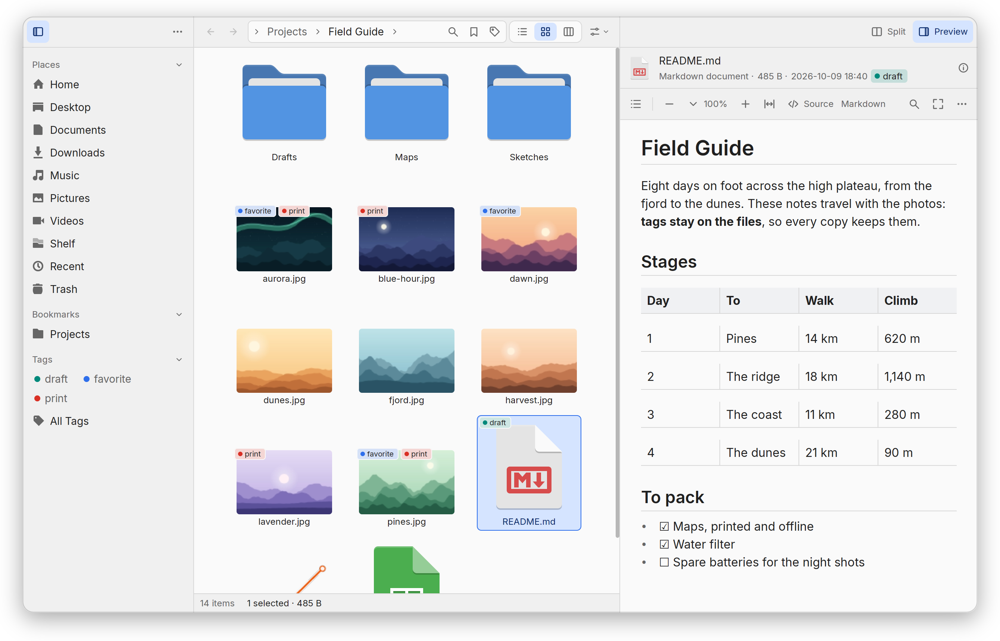

<p align="center">
  
</p>

<h1 align="center">skwir</h1>

<p align="center">
  A fast file manager that can be driven equally by humans and AI agents.
</p>

<p align="center">
  <a href="https://skwir.org"><b>Website</b></a> ·
  <a href="https://skwir.org/download"><b>Download</b></a> ·
  <a href="https://skwir.org/docs"><b>Documentation</b></a> ·
  <a href="CHANGELOG.md"><b>Release notes</b></a> ·
  <a href="CONTRIBUTING.md"><b>Contributing</b></a>
</p>

<p align="center">
  <picture>
    <source media="(prefers-color-scheme: dark)" srcset="docs/images/screenshot-dark.png">
    
  </picture>
</p>

Skwir is written in Rust on gpui, Zed's GPU-accelerated toolkit. Version 0.1 is
for Linux (Wayland or X11, with Vulkan). The macOS and Windows code compiles but
has never run on either system: see [how to help](docs/HELP-WANTED.md).

## Features

**Browsing**

- Views: list (columns chosen from its header), grid with thumbnails,
  columns, tree, and a board of a folder's folders as card columns. Usage
  draws what takes the room in a folder; Timeline charts when files changed;
  Map places pictures, tracks and flight plans where they were taken or go.
- Two panes (side by side or stacked) and tabs. Folders stream in as they
  are read, however many entries they hold.
- A sidebar of places you arrange: your folders, bookmarks, saved searches,
  tags, Recent, the Trash, and drives, which mount and unlock (LUKS) from it.
- Jump to folders you used before (zoxide's list and the desktop's recent
  files); type a path or filter the folder from the address bar; a terminal
  panel that follows the folder shown.

**Searching**

- A query language: names, extensions, kinds and MIME types, sizes, dates
  (in your time zone and week), tags, ratings, comments, file contents (text
  or a regex) and positions, combined with `OR`, `NOT` and parentheses.
- A search is a location: Back returns to it, it opens in a tab, and it can
  be kept in the sidebar. Baloo and plocate are used to go faster where they
  run; the files themselves are always checked.

**Changing files**

- Copy, move, link, rename, trash and delete, from keys, menus or drag and
  drop (which asks whether to move, copy or link). Bulk rename with a preview
  of every name; a folder's names edited as text in `$EDITOR`.
- Every change is a plan of steps with inverses: Undo and Redo cover them all,
  and changes to many files, or proposed by a plugin or an agent, are reviewed
  before they run.
- Long operations can be paused and cancelled. Copies onto USB drives go at
  the drive's pace; a copy short of room asks first; quitting mid-copy asks,
  then removes the partial files; hard links stay hard links.
- The Trash is a place: restore a file where it was, or wherever it is
  dropped. Archives are browsed and extracted.

**Tags, ratings and comments**

- Kept on the files, where other applications read them: extended attributes
  (Dolphin's keys), XMP sidecars (darktable, Lightroom), a Mac's Finder tags
  and `._` files, TagSpaces' sidecars, tags in file names. Stores that
  disagree are merged; copies keep everything.
- Tags can have categories (`Places/France/Paris`) and are browsed as folders
  (`tags:/`); a category can hold one tag at a time, like a field.

**Previews**

- Text and code highlighted with bat's grammars; Markdown and HTML in a
  reading mode; CSV, JSON Lines, Excel and SQLite tables; JSON, YAML and TOML
  folded.
- PDFs in a reader (PDFium, Poppler or MuPDF) with search, contents and text
  selection; Word and OpenDocument files, EPUB books, comics, e-mail and
  Jupyter notebooks.
- Pictures (HEIC, AVIF, RAW and more through the desktop's thumbnailers or
  ImageMagick), and an audio and video player that can keep playing while you
  browse, steered by the desktop's media keys.
- Fonts, 3D models, CAD drawings and G-code, KiCad boards and Gerber files,
  GPS tracks on a map, files inside archives, and any file's bytes.
  [Previews](docs/previews.md) lists them all.

**Design**

- No daemon and no database: thumbnails, icons, the MIME database, bookmarks
  and recent files are the desktop's, and Skwir's one cache can be deleted at
  any time. Converters run sandboxed (bubblewrap).
- Every action is a command with a JSON schema, shared by the keys, the
  palette, the command line and AI agents ([Scripts and
  agents](#scripts-and-agents)).
- Everything beyond a small core is a plugin that can be turned off; plugins
  from outside Skwir run as WebAssembly modules or isolated programs
  ([below](#plugins-from-outside-skwir)).

## Installing

**Packages** for Debian and Ubuntu (`.deb`) and Fedora (`.rpm`) come with each
release; Arch's are in the AUR. The `skwir` package holds the program and its
PDF, archive and 3D-model helpers. The rest is optional:

| Package         | Adds                                                  |
| --------------- | ----------------------------------------------------- |
| `skwir-media`   | Audio and video, through GStreamer                    |
| `skwir-poppler` | PDFs through Poppler (GPL), beside PDFium             |
| `skwir-mermaid` | Mermaid diagrams in Markdown                          |
| `skwir-mupdf`   | PDFs and books laid out in pages through MuPDF (AGPL) |

On Arch, `skwir` includes the player and the Poppler reader, with their
libraries as optional dependencies.

**AppImage**, built on x86-64 Linux (NixOS included):

```sh
nix develop --command just package-appimage
```

The verified `skwir-<version>-x86_64.AppImage` and its checksum land in
`target/package/appimage`.
The build uses an Ubuntu 22.04 root of its own and keeps its cache in
`target/appimage`; the first build downloads its toolchain and libraries.
On NixOS, run the resulting image through `appimage-run`. On other desktops,
make it executable and run it directly.
The image includes the optional readers and player; system tools such as
LibreOffice and bubblewrap remain the host's ([ADR-052](docs/adr/052-portable-appimage.md)).

**Nix and Home Manager**: the flake builds skwir with its helpers
(`nix build github:skwir-org/skwir`) and has an overlay. Its Home Manager
module installs skwir and writes the settings you declare, checked by skwir
while the configuration builds: linked read-only, or with `mutableSettings`
merged into the writable file at each activation, so skwir's Settings can
change the rest. A running skwir takes them in
([ADR-055](docs/adr/055-the-settings-file-is-shared.md),
[ADR-056](docs/adr/056-the-window-s-state-is-not-a-setting.md)):

```nix
imports = [ inputs.skwir.homeManagerModules.default ];
programs.skwir = {
  enable = true;
  settings = {
    core.startup = "last";
    plugins.control.enabled = true;
  };
};
```

`mutableSettings` needs a recent Home Manager, one with mutable settings.

**From source**, with Rust 1.96 or later and the libraries `flake.nix` lists
(the Nix flake has everything):

```
direnv allow                # or: nix develop
just run ~/Documents        # or: cargo run --release -p skwir -- ~/Documents
```

Maintainers can build checked Linux releases on a Nix host with
`just release-build v<version>` and upload a GitHub draft with
`just release-upload v<version>`. See [Releasing](docs/RELEASING.md) for
the required clean tag, release metadata, checks and package outputs.

## First steps

| Keys                     | Action                                        |
| ------------------------ | --------------------------------------------- |
| `Ctrl+Shift+P`           | Command palette: every command, with its keys |
| `F1`                     | The keys that work where you are              |
| `Ctrl+L`, `Ctrl+F`       | Type a path; search                           |
| `Ctrl+1`, `2`, `3`       | List, grid, columns                           |
| `Space`, `F11`           | Peek at a file; the preview panel             |
| `F3`, `Tab`              | Split into two panes; switch pane             |
| `Ctrl+T`, `Ctrl+W`       | New tab; close tab                            |
| `F2`, `Ctrl+Shift+N`     | Rename; new folder                            |
| `Delete`, `Shift+Delete` | Move to Trash; delete for good                |
| `Ctrl+Z`, `Ctrl+Shift+Z` | Undo; redo                                    |
| `Ctrl+D`                 | Keep this place in the sidebar                |
| `Ctrl+,`                 | Settings                                      |

The [user guide](docs/guide.md) covers the rest.

## Scripts and agents

Turn on **Agents and scripts** in Settings › Plugins. The open window then
listens on a channel only your user account can reach. It is off by default
because any program running as you can use it.

- **Scripts:** `skwir cmd [--apply] <command> [<JSON arguments>]` runs one
  command and prints its result as JSON (`skwir cmd entries` lists what the
  active pane shows). A command that changes files prints its plan; `--apply`
  applies it as your own action, undoable in the window.
- **Agents:** an MCP client starts `skwir mcp` (Claude Code:
  `claude mcp add skwir -- skwir mcp`). Every command is a tool. Changes an
  agent wants are proposed in the window for review; a command that acts without
  a plan waits until you allow it.

**Private folders** (Settings › Privacy) never leave the machine: agents never
see their names or contents, and plugins from outside Skwir are never handed
them. `~/.ssh`, `~/.gnupg` and similar folders are private from the start, as is
any folder holding a file named `.private`.

## Plugins from outside Skwir

A plugin can be a folder with a `plugin.toml` and either a WebAssembly module or
a program speaking JSON lines. It can provide fields, thumbnails, previews and
commands, stays off until you turn it on in Settings › Plugins (which shows what
it may do), and gets nothing it did not declare. The protocol is experimental in
0.1: [writing a plugin](docs/plugins/README.md).

## Documentation

The documentation is online at [skwir.org/docs](https://skwir.org/docs), and in
this repository ([index](docs/README.md)):

- [User guide](docs/guide.md): views, searching, tags, previews, files,
  settings, where things are kept.
- [Previews](docs/previews.md): every kind of file Skwir previews, and what each
  needs installed.
- [Writing a plugin](docs/plugins/README.md) and
  [its protocol](docs/plugins/protocol.md).
- [Contributing](CONTRIBUTING.md) and [`AGENTS.md`](AGENTS.md), the rules the
  code follows, for people and agents.
- [The plan](docs/PLAN.md): status and what is left; [decisions](docs/adr/) that
  closed a door.
- [Helping with macOS and Windows](docs/HELP-WANTED.md).

## License

Skwir is under the Apache License 2.0 ([`LICENSE`](LICENSE)), and so are
contributions to it (section 5 of the licence). The Poppler and MuPDF readers
are separate programs that link libraries under the GPL and the AGPL;
distributed, they are under the GPL version 3 and the AGPL version 3
respectively. Skwir itself links neither
([ADR-042](docs/adr/042-apache-2.0.md)). Each package carries the notices of the
crates its programs are built from (`THIRD-PARTY-NOTICES`).
